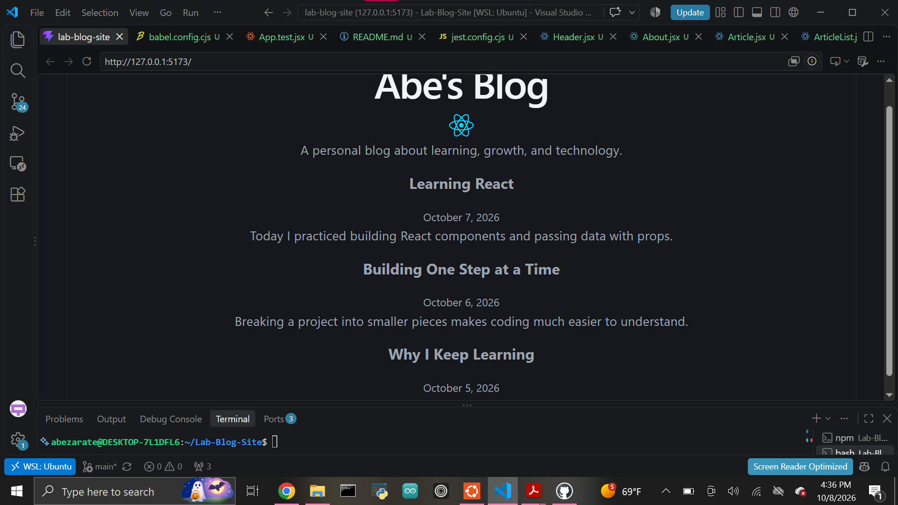

# Abe's Blog

A simple personal blog built with React and Vite. This project practices creating reusable React components and passing data through props.

## Features

- Displays a blog name and logo
- Shows an about section
- Renders multiple blog articles from data
- Uses props to pass data between components
- Includes a Jest test for prop-based rendering

## Components

- `Header` - Displays the blog name.
- `About` - Displays the blog logo and description.
- `ArticleList` - Maps through the blog posts and renders an Article for each post.
- `Article` - Displays an article title, date, and preview.

## How to Run the Project

1. Clone the repository.
2. Open the project folder in a terminal.
3. Install dependencies:

npm install

4. Start the development server:

npm run dev

5. Open the local URL shown in the terminal.

## Testing

Run the Jest test with:

npx jest

Run ESLint with:

npm run lint

## Screenshot

